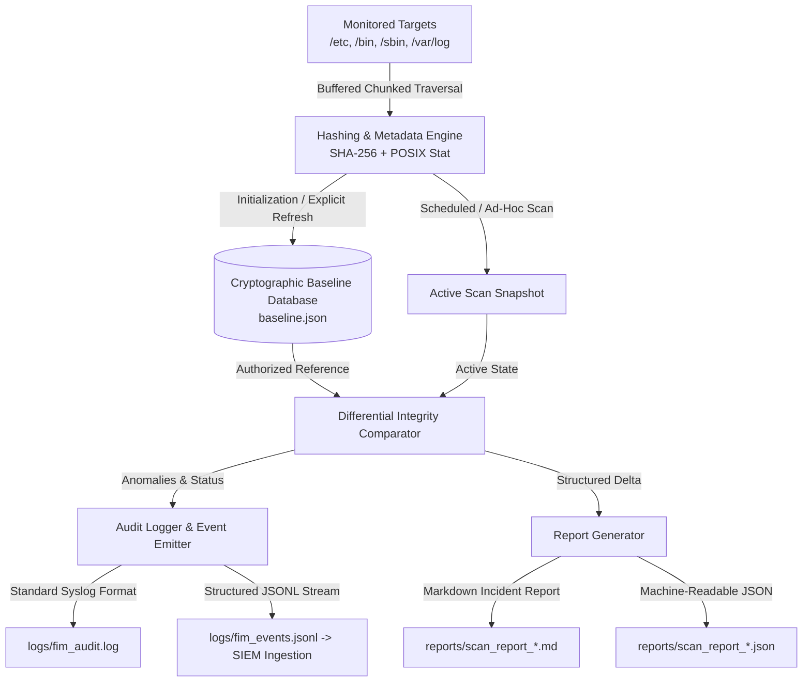

# Linux File Integrity Monitoring Utility

[](https://www.python.org/)
[](https://csrc.nist.gov/)
[](https://csrc.nist.gov/publications/detail/fips/180/4/final)
[](https://www.elastic.co/what-is/elk-stack)
[](https://docs.python.org/3/library/)
[](LICENSE)

A host-based intrusion detection utility (HIDS) engineered in Python to establish cryptographic baselines of critical file systems, detect unauthorized alterations, isolate tampering, and generate forensically sound audit logs and incident investigation reports.

Developed as a cybersecurity engineering portfolio project demonstrating core Blue Team, host hardening, and SOC analysis concepts.

---

## 📌 Executive Summary & Key Highlights

File Integrity Monitoring (FIM) is a foundational security control mandated across enterprise compliance frameworks (**PCI-DSS 11.5**, **NIST SP 800-53 SI-7**, **ISO 27001 A.12.2**). When an adversary achieves initial access or privilege escalation on a Linux host, they inevitably interact with the file system: modifying system binaries, altering user account databases, dropping web shells or scheduled cron jobs, or deleting logs to evade detection.

This utility provides automated host-level verification by:
1. **Cryptographic Fingerprinting**: Hashing files using chunk-buffered **SHA-256** and cataloging POSIX permissions, size, UID/GID, and timestamps.
2. **Deterministic Catalog Checksums**: Defending the baseline database itself against unauthorized manual modification.
3. **Differential Detection**: Accurately distinguishing between **Content Modifications**, **Newly Dropped Files**, **Deleted Files**, and **Permission/Metadata Alterations**.
4. **Zero-Silent-Update Policy**: Enforcing strict human authorization before refreshing security baselines.
5. **Dual-Format SOC Audit Logging**: Producing human-readable administrative logs alongside structured **JSON Lines (JSONL)** events for seamless ingestion into **Splunk**, **Wazuh**, or **Elastic (ELK)**.
6. **Executive Incident Reporting**: Automatically generating Markdown investigation reports equipped with MITRE ATT&CK® mappings and incident response playbooks.
7. **Pure Standard Library**: Zero external package friction; runs out-of-the-box on Linux, macOS, and Windows.

---

## 🏛️ System Architecture



---

## 📂 Repository Structure

```text
linux-file-integrity-monitor/
├── README.md                          # Comprehensive project documentation
├── LICENSE                            # MIT License
├── .gitignore                         # Git exclusion rules
├── requirements.txt                   # Standard library (zero mandatory external dependencies)
├── main.py                            # Unified CLI application entrypoint
├── fim/                               # Core Python FIM package
│   ├── __init__.py                    # Package exports & versioning
│   ├── hashing.py                     # Chunk-buffered SHA-256 & POSIX metadata capture
│   ├── baseline.py                    # Atomic persistence & catalog integrity verification
│   ├── scanner.py                     # Safe filesystem traversal & pattern exclusion
│   ├── comparison.py                  # Differential comparison & severity classification
│   ├── audit_logger.py                # Dual-channel text and JSONL SIEM event logging
│   └── report_generator.py            # Markdown, plain text, and JSON report generator
├── config/
│   └── monitor_config.json            # Target paths, exclusion rules, and alert settings
├── tests/                             # Automated test suite (17 unit & integration tests)
│   ├── test_hashing.py                # Cryptographic hash calculation tests
│   ├── test_baseline.py               # Baseline lifecycle, serialization, & tampering tests
│   ├── test_comparison.py             # Differential logic & severity grading tests
│   └── test_file_changes.py           # End-to-end simulated tampering lifecycle tests
├── sample-data/                       # Safe mock Linux filesystem for cross-platform testing
│   ├── etc/                           # Mock /etc (passwd, shadow, sshd_config)
│   ├── bin/                           # Mock /bin (login)
│   ├── var/log/                       # Mock /var/log (auth.log)
│   └── README.md                      # Attack simulation exercises
├── reports/                           # Generated incident investigation reports
│   └── README.md                      # Report directory overview
├── logs/                              # Audit logs and SIEM event streams
│   └── README.md                      # Log format documentation
└── docs/                              # In-depth technical documentation
    ├── architecture.md                # System architecture, data flow, & design patterns
    ├── installation-and-usage.md      # CLI reference, cron jobs, & systemd timers
    ├── investigation-report.md        # SOC incident triage report scenario (INC-2026-1029)
    ├── security-considerations.md     # TOCTOU, baseline defense, & defense-in-depth
    └── limitations.md                 # User-space vs kernel auditd, rootkits, & roadmap
```

---

## ⚡ Quickstart: Running in 30 Seconds

### 1. Run Automated Attack Simulation Demo
The utility includes a built-in automated demonstration that baselines the environment, simulates real adversary actions (UID 0 account injection, backdoor staging, log wiping), triggers detection, produces incident reports, and restores the files:

```bash
python main.py demo
```

### 2. Standard Operational Workflow

#### Step 1: Establish Initial Cryptographic Baseline
```bash
python main.py init
```
*Creates `baseline.json` containing SHA-256 hashes, file modes, sizes, and a catalog integrity checksum.*

#### Step 2: Run Verification Scan
```bash
python main.py scan
```
*Compares live files against `baseline.json`. If clean, returns exit code 0; if tampering is detected, returns exit code 2 and outputs a formatted terminal report.*

#### Step 3: Check Current Status
```bash
python main.py status
```
*Displays baseline metadata, total indexed files, catalog checksum, and logging status.*

#### Step 4: Verify Single File
```bash
python main.py verify sample-data/etc/passwd
```

#### Step 5: Explicitly Refresh Baseline (After Authorized Updates)
```bash
python main.py update
```
*Never updates silently. Prompts the operator for explicit confirmation and records an audit log.*

---

## 🎯 Threat Detection & MITRE ATT&CK® Mapping

| Adversary Technique | Real-World Attack Scenario | FIM Detection & Event Category | Alert Severity |
| :--- | :--- | :--- | :--- |
| **T1098** (Account Manipulation) | Adversary injects rogue UID 0 account into `/etc/passwd` | Content hash mismatch (`FILE_MODIFIED`) | **CRITICAL** |
| **T1036** (Masquerading) | Adversary drops unauthorized payload in `/bin/backdoor.sh` | Uncataloged file discovered (`FILE_ADDED`) | **CRITICAL** |
| **T1070.004** (Indicator Removal) | Adversary deletes `/var/log/auth.log` to obscure tracks | Missing baseline asset (`FILE_DELETED`) | **HIGH** |
| **T1222.002** (Permission Modification) | Adversary sets SUID bit (`chmod u+s`) or runs `chmod 777` | Octal mode altered (`FILE_METADATA_CHANGED`) | **CRITICAL / HIGH** |
| **T1565.001** (Stored Data Manipulation) | Defacing web files or modifying service configurations | Hash & size delta (`FILE_MODIFIED`) | **HIGH** |

---

## 📊 Sample Terminal & Incident Report Output

### Terminal Output
```text
======================================================================
           LINUX FILE INTEGRITY MONITOR - SCAN REPORT SUMMARY
======================================================================
 Status:               VIOLATIONS_DETECTED
 Baseline Files:       5
 Current Files:        5
 Modified Files:       1
 Added Files:          1
 Deleted Files:        1
 Metadata Changes:     0
 Unchanged (Verified): 3
 Critical Alerts:      2
 Scan Duration:        0.0084 seconds
----------------------------------------------------------------------
 DETECTED ANOMALIES:
   [CRITICAL] ADDED: sample-data/bin/backdoor.sh
          Details: New file discovered. Not present in established baseline.
   [CRITICAL] MODIFIED: sample-data/etc/passwd
          Details: Cryptographic hash mismatch. Content modified! 
                   Baseline: 92d18587b376... -> Current: 7c9eaaa4333a... (+60 bytes)
   [HIGH] DELETED: sample-data/var/log/auth.log
          Details: File recorded in baseline is missing from the active filesystem.
======================================================================
[+] Markdown report saved: reports/scan_report_20261029_164936.md
[+] JSON report saved:     reports/scan_report_20261029_164936.json
```

### SIEM-Ready JSONL Stream (`logs/fim_events.jsonl`)
```json
{
  "event_id": "84d59f71-6c28-4ee1-b0e6-60721867e3a9",
  "timestamp": "2026-10-29T16:49:36.832410+00:00",
  "host": "prod-linux-node01",
  "event_type": "FILE_MODIFIED",
  "severity": "CRITICAL",
  "file_path": "sample-data/etc/passwd",
  "message": "Cryptographic hash mismatch. Content modified!",
  "data": {
    "baseline_sha256": "92d18587b37683e1b60bb33ee4a4d272eec5c65bd26a85ba17f76424e853629c",
    "current_sha256": "7c9eaaa4333a9cefdceadfaeb4459f972b22668fcb52784570076a08625aa8a9",
    "baseline_size": 1360,
    "current_size": 1420
  }
}
```

---

## 🧪 Automated Testing

The project includes unit and integration tests covering all modules:

```bash
# Run all tests using Python standard unittest test runner
python -m unittest discover tests -v
```

### Test Coverage Highlights:
- **`test_hashing.py`**: Validates chunked streaming on large/small files, standard known SHA-256 digests, empty files, and permission errors.
- **`test_baseline.py`**: Validates atomic write operations, JSON serialization, schema consistency, and tampering detection via catalog checksums.
- **`test_comparison.py`**: Tests differential logic across additions, deletions, modifications, and permissions changes with severity classification.
- **`test_file_changes.py`**: Full lifecycle test on a live filesystem verifying baseline creation, clean scan, adversary tampering detection, and explicit refresh.

---

## 💼 SOC Analyst & Cybersecurity Interview Talking Points

When presenting this project in a security interview, leverage these technical highlights:

1. **Why SHA-256 over MD5 / SHA-1?**
   *MD5 and SHA-1 suffer from proven cryptographic collision attacks (e.g., Flame malware, SHAttered). SHA-256 remains collision-resistant and complies with FIPS 180-4 and enterprise compliance frameworks.*

2. **Why Chunked Streaming Hashing?**
   *Reading entire files into memory with `.read()` causes memory spikes and crashes on large system files or database logs. Chunked 64 KB streaming ensures memory usage remains flat and predictable regardless of file size.*

3. **How is Baseline Poisoning Prevented?**
   *A common flaw in basic FIM tools is that an attacker with root can modify the baseline file. We address this using a deterministic **Catalog Checksum** over sorted records, support for Linux immutable attributes (`chattr +i baseline.json`), and atomic write replacement to prevent race-condition truncation.*

4. **Why is a "Zero Silent Update" Policy Essential?**
   *If a FIM utility automatically updates its baseline whenever a change is detected, it becomes an accomplice to the intruder by validating malicious modifications as normal. Updates must require explicit human confirmation.*

5. **User-Space Polling vs. Kernel-Space Hooking (`auditd` / `eBPF`):**
   *This utility performs user-space polling, which is portable, dependency-free, and ideal for scheduled integrity verification. However, an enterprise defense-in-depth architecture pairs scheduled cryptographic FIM with kernel-level tools (`auditd`, `fanotify`, or eBPF) for real-time syscall capture.*

---

## 📜 License

Distributed under the **MIT License**. See [LICENSE](LICENSE) for details.
