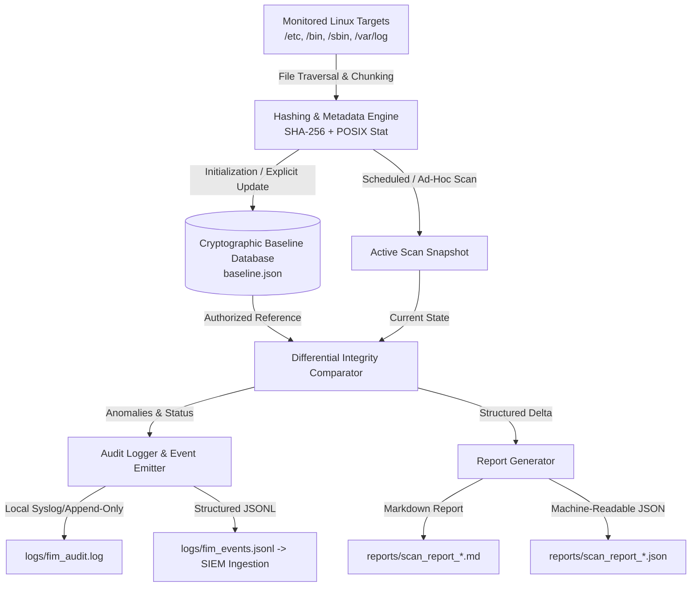

# Linux File Integrity Monitoring Utility - Architecture & System Design

## 1. Overview & System Mission

The **Linux File Integrity Monitoring (FIM)** utility is a host-based intrusion detection component (HIDS) engineered to establish authoritative cryptographic baselines of critical file system assets, detect unauthorized alterations in real-time or scheduled intervals, and generate forensically sound audit logs and incident reports for Security Operations Center (SOC) triage.



---

## 2. Core Subsystems

### 2.1 Hashing & Metadata Engine (`fim/hashing.py`)
- **Cryptographic Digest**: Utilizes standard SHA-256 (`hashlib.sha256`) with a 64 KB (65,536 bytes) chunk buffer. Streaming reads prevent memory exhaustion on large binaries, shared objects, or log files.
- **POSIX Attribute Harvesting**: Captures file size, last modified time (RFC 3339 / ISO 8601 UTC), file mode/permissions (octal representation, e.g., `0644`), UID/GID, resolved username/group via `pwd` and `grp` (with platform-agnostic fallback on non-POSIX systems), and inode numbers.
- **Resilient Fault Handling**: Gracefully intercepts `PermissionError`, missing files, and race conditions (`FileNotFoundError` mid-read), logging structured alerts without halting the scan engine.

### 2.2 File Scanner & Filter Engine (`fim/scanner.py`)
- **Traversal Strategy**: Performs recursive directory walking (`os.walk`) with cycle detection using `(st_dev, st_ino)` tuples to safeguard against malicious or accidental symlink loops.
- **Pattern Filtering**: Implements glob-based inclusion and exclusion logic (`fnmatch`). Automatically skips temporary files, editor swap files (`*.swp`), and version control directories (`.git/*`).
- **Path Canonicalization**: Normalizes all filesystem paths to standard POSIX-format relative/absolute strings to ensure deterministic cross-platform comparison.

### 2.3 Baseline Database Manager (`fim/baseline.py`)
- **Document Structure**: Persists metadata in a structured JSON catalog containing schema version, generation timestamp, host environment context (hostname, OS, release, architecture, Python version), monitored path roots, file record mapping, and a **Catalog Checksum**.
- **Catalog Self-Integrity Checksum**: Computes an aggregate SHA-256 hash over the sorted, canonicalized file catalog. If an adversary attempts to modify `baseline.json` with an editor to authorize a trojan, the catalog checksum validation fails during scan initialization.
- **Atomic Persistence**: Implements atomic write semantics via `tempfile` and `os.replace` on the same file system, preventing database corruption if a process is killed or interrupted mid-write.
- **Zero Silent Updates Rule**: Strictly prohibits automated baseline modification. All baseline changes require explicit user invocation (`main.py update` or `main.py init --force`).

### 2.4 Integrity Comparator (`fim/comparison.py`)
- **Differential Classification**:
  - `MODIFIED`: Existing file whose SHA-256 digest differs from baseline.
  - `ADDED`: New file present on disk but absent from baseline.
  - `DELETED`: Baseline file missing from active filesystem.
  - `METADATA_CHANGED`: File whose cryptographic hash matches, but permissions (e.g. `chmod 777`), owner, or size have been altered.
  - `UNCHANGED`: Cryptographically and metadata-verified authentic.
- **Severity Rating Engine**: Maps discrepancies against high-criticality patterns (`*passwd*`, `*shadow*`, `*sudoers*`, `*sshd_config*`, `*/bin/*`, `*/sbin/*`). Content modifications or deletions of critical files escalate automatically to `CRITICAL` severity.

### 2.5 Audit Logger & SIEM Emitter (`fim/audit_logger.py`)
- **Human-Readable Text Log (`logs/fim_audit.log`)**: Standard timestamped logs (`[YYYY-MM-DD HH:MM:SS] [LEVEL] [EVENT] Message`) for system administrators and terminal operators.
- **Structured SIEM Stream (`logs/fim_events.jsonl`)**: Emits single-line JSON records formatted for direct ingestion into Splunk, Elastic/ELK, Wazuh, or cloud SIEM solutions. Each record includes a unique `event_id` (UUIDv4), ISO 8601 UTC timestamp, hostname, event category, severity rating, affected path, and before/after cryptographic metadata.

### 2.6 Report Generator (`fim/report_generator.py`)
- **Executive Markdown Reports**: Generates formal incident investigation reports including status badges, quantitative metric tables, detailed finding logs, MITRE ATT&CK mapping, and SOC remediation playbooks.
- **JSON & Plain Text Exports**: Programmatic JSON artifacts for CI/CD pipeline automation and concise ASCII tables for email alerts.

---

## 3. Threat Model & MITRE ATT&CK® Mapping

| Adversary Technique | Threat Description | FIM Detection Mechanism |
| :--- | :--- | :--- |
| **T1565.001 - Stored Data Manipulation** | Adversary alters system binaries or web applications | SHA-256 hash mismatch flags `MODIFIED` anomaly |
| **T1098 - Account Manipulation** | Adversary injects rogue user into `/etc/passwd` | Immediate `CRITICAL` alert on `/etc/passwd` hash change |
| **T1053.003 - Scheduled Task: Cron** | Persistence established via `/etc/cron.*` scripts | Detected as `ADDED` or `MODIFIED` in cron targets |
| **T1070.004 - Indicator Removal: File Deletion** | Adversary wipes `/var/log/auth.log` or audit trails | Detected as `DELETED` anomaly against baseline |
| **T1036 - Masquerading** | Placing malicious payloads disguised as system utilities | `ADDED` event in monitored directories |
| **T1222.002 - Linux File & Directory Permissions Modification** | Setting SUID bit (`chmod u+s`) or opening permissions | `METADATA_CHANGED` alert isolating mode alteration |

---

## 4. Baseline JSON Schema Specification

```json
{
  "schema_version": "1.0.0",
  "created_at": "2026-10-29T10:00:00.000000+00:00",
  "updated_at": "2026-10-29T10:00:00.000000+00:00",
  "hash_algorithm": "sha256",
  "host_context": {
    "hostname": "prod-linux-node01",
    "os_name": "Linux",
    "os_release": "6.5.0-generic",
    "architecture": "x86_64",
    "python_version": "3.10.11"
  },
  "monitored_paths": ["/etc", "/bin", "/sbin"],
  "total_files": 482,
  "catalog_checksum": "a8f3b4c102...",
  "files": {
    "/etc/passwd": {
      "path": "/etc/passwd",
      "sha256": "4b227777d4dd1fc61c6f884f48641d02b4d121d3fd328cb08b5531fcacdabf8a",
      "size_bytes": 1420,
      "mtime_iso": "2026-10-29T09:45:00+00:00",
      "mtime_epoch": 1793267100.0,
      "mode_octal": "0644",
      "owner": "root",
      "group": "root",
      "is_symlink": false,
      "inode": 131075
    }
  }
}
```
